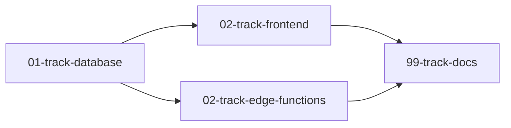

# Feature Planner

Analisa projetos existentes (código + banco) e gera prompts de implementação para o Codex, sem quebrar o que já funciona. Quando possível, divide os prompts em **tracks paralelas** que podem rodar em múltiplas sessões simultâneas, acelerando o desenvolvimento.

A razão de existir dessa skill é simples: gerar prompts "no escuro" — sem ler o código e o banco — é a principal causa de regressões. Cada prompt precisa respeitar os padrões, nomes, tipos e constraints que já existem. Por isso o fluxo começa sempre por leitura, nunca por escrita.

**Paralelismo:** O Codex suporta múltiplas sessões simultâneas. Quando a feature tem áreas independentes (ex: edge function isolada + UI; migrations não acopladas a hooks), a skill divide os prompts em arquivos por **track** (frontend, backend/DB, edge function, integração) para que o desenvolvedor possa rodar 2-3 janelas em paralelo. Quando não há paralelismo real, mantém arquivo único — não força split desnecessário.

**Princípio inegociável:** Esta skill NUNCA supõe regras de negócio. Se a feature envolve qualquer mudança de lógica (cálculo, condicional, fluxo de aprovação, RBAC, validação, exceção), a skill PARA na Fase 0 e questiona o usuário com recomendações fundamentadas até obter validação explícita de TODAS as regras. Veja o "Gate de regras de negócio" na Fase 0.B.

---

## Ciclo de vida do projeto Fainow

Esta skill é a **Fase 6 (Iterar)** do ciclo de vida completo. É a skill mais usada no dia a dia — cada nova feature, bugfix ou refatoração passa por aqui.

```
Fase 1 — ENTENDER:  product-discovery
Fase 2 — PLANEJAR:  eap-project-planner + database-architect
Fase 3 — CONSTRUIR: Execução dos prompts de kickstart
Fase 4 — LIMPAR:    codebase-cleanup
Fase 5 — DOCUMENTAR: project-docs-bootstrap (cria .Codex/)
      ↓
Fase 6 — ITERAR
  ★ feature-planner ★  ← ESTA SKILL
  Input: repo + banco + pasta .Codex/ + descrição da feature
  Output: prompts sequenciais + atualização dos docs .Codex/
  → volta para Fase 4 (Limpar) se o sprint acumulou código órfão
```

### Pré-requisito: pasta `.Codex/` existir

O ideal é que o `project-docs-bootstrap` tenha rodado antes, criando o AGENTS.md e a pasta `.Codex/` com os arquivos globais e de fluxo. Se não existir, esta skill funciona — mas com overhead (Fase 0 detecta ausência e compensa na Fase 6).

### Próximo passo após esta skill

Após implementar a feature e atualizar os docs, se o sprint acumulou artefatos indesejados do vibe coding, sugira rodar `codebase-cleanup` antes do próximo sprint.

---

## Inputs necessários

O usuário DEVE fornecer (ou você deve perguntar):

1. **Repositório GitHub** — owner/repo (ex: `FainowAI/fainow-crm`)
2. **MCP do banco de dados** — qual MCP usar para ler a base (ex: `supabase-fainow`, `supabase-be56`)
3. **Descrição da feature** — o que o usuário quer implementar

Se o usuário não fornecer repo ou MCP, pergunte antes de iniciar. Se o contexto da conversa ou a memória indicam qual usar, confirme rapidamente e prossiga.

## Workflow (7 fases + gate de regras + análise de dependências + prompt final obrigatório)

Execute TODAS as fases em sequência. Cada fase produz insumo para a próxima. A Fase 0 tem duas partes (0.A leitura + 0.B gate de regras de negócio). A Fase 4.5 decide se a entrega será arquivo único ou pacote de tracks paralelas.

---

### FASE 0 — Leitura da pasta `.Codex/` + Gate de regras de negócio

**Objetivo:** Carregar a memória do projeto antes de tocar em qualquer código E garantir que NENHUMA regra de negócio seja suposta. Esta fase tem duas partes: leitura (0.A) e gate bloqueante (0.B).

---

#### FASE 0.A — Leitura da pasta `.Codex/`

**Ações:**

1. Use `github:get_file_contents` para ler o conteúdo da pasta `.Codex/` na raiz do repositório.

2. **Se a pasta `.Codex/` existir, leia em ordem de prioridade:**

   **Nível 1 — Arquivos globais (ler sempre que existirem):**
   - `state.md` — ler PRIMEIRO. Contém o estado da última sessão: o que foi feito, pendências, notas. Se houver pendências relevantes para a feature atual, considere-as.
   - `requirements.md` — regras de negócio do projeto. A feature que será implementada DEVE respeitar essas regras. Se a feature precisa violar alguma, reporte ao usuário.
   - `roadmap.md` — o que foi feito, o que está em andamento, o que falta. Verifique se a feature solicitada está no roadmap (contexto útil para priorização).
   - `project.md` — visão do produto, público-alvo, decisões arquiteturais. Contexto de alto nível.

   **Nível 2 — Arquivos de fluxo (ler os relevantes):**
   - Identifique quais `fluxo-*.md` são relevantes para a feature
   - Use esse conteúdo como contexto primário — descreve como os fluxos funcionam, componentes, hooks, regras de negócio implementadas
   - **Isso substitui parcialmente a leitura arquivo por arquivo na Fase 1** — se o `.md` já documenta o fluxo, foque nos pontos de alteração
   - Identifique quais arquivos precisarão ser ATUALIZADOS na Fase 6

3. **Se a pasta `.Codex/` NÃO existir ou estiver vazia:**
   - Registre: `CLAUDE_DOCS_MISSING = true`
   - Na Fase 4, inclua prompt extra para criar a pasta e documentar o fluxo
   - Considere sugerir ao usuário rodar `project-docs-bootstrap` antes, se o projeto for grande

4. **Se a pasta `.Codex/` existir mas NÃO tiver docs relevantes para a feature:**
   - Os docs de outros fluxos ficam intactos
   - Na Fase 6, crie novo arquivo para o fluxo adicionado/alterado

**Formato esperado dos arquivos `.Codex/`:**
- Globais: `project.md`, `requirements.md`, `roadmap.md`, `state.md`, `fluxo-infraestrutura.md`
- Por fluxo: `fluxo-[area-do-sistema].md` (ex: `fluxo-pipeline-leads.md`)

---

#### FASE 0.B — Gate bloqueante de regras de negócio

**⚠️ REGRA INEGOCIÁVEL:** Se a feature envolve QUALQUER mudança de lógica, esta skill NÃO PODE prosseguir para a Fase 1 sem antes obter respostas explícitas do usuário. Sem exceção. Sem suposição. Sem "vou assumir que…".

**Detecção da necessidade de gate (combinação de 3 sinais):**

**1. Lista de gatilhos explícitos** — se a feature envolve QUALQUER um destes, o gate é OBRIGATÓRIO:

| Gatilho | Exemplo |
|--------|---------|
| Cálculo ou agregação | "calcular comissão", "somar pontos", "média de tempo" |
| Critério de classificação | "lead BLACK", "vendedor TOP", "produto premium" |
| Fluxo de aprovação ou estado | "aprovar pedido", "moderar comentário", "validar contrato" |
| Condicional de negócio | "se o cliente for X, então Y", "exceto quando", "apenas para" |
| Permissão / RBAC | "só admin pode", "vendedor não vê", "apenas o dono" |
| Visibilidade condicional na UI | "esconder botão se", "mostrar aba apenas para" |
| Validação ou restrição | "não permitir mais de N", "bloqueia se faltar X" |
| Trigger de evento ou notificação | "notificar quando", "envia email se", "dispara webhook" |
| Mudança de prazo, SLA ou cronograma | "vence em N dias", "lembrete depois de" |
| Tratamento de exceção | "o que fazer se faltar dado", "fallback para" |
| Migração ou backfill de dados | "atualizar registros antigos", "preencher coluna nova" |

**2. Heurística automática** — mesmo sem gatilho explícito, ative o gate se:
- A feature menciona qualquer verbo de comportamento (calcular, validar, decidir, classificar, filtrar, priorizar, autorizar, recomendar)
- O pedido contém condicionais ("se", "quando", "exceto", "apenas")
- A feature toca código que já tem lógica condicional documentada em `requirements.md` ou em `fluxo-*.md`
- A leitura da Fase 0.A revelou regra existente que pode entrar em conflito

**3. Checagem com usuário em caso de ambiguidade** — se a heurística disser "talvez", PERGUNTE diretamente:

> "Esta feature envolve alguma regra de negócio nova ou alteração de lógica existente? (Sim / Não / Não tenho certeza)"

Se a resposta for "Sim" ou "Não tenho certeza", o gate ativa. Se for "Não", documente a decisão no documento final ("Confirmado pelo usuário: feature sem mudança de lógica") e prossiga.

**Exceção ÚNICA ao gate:** Bugfix cirúrgico de UMA linha em UM arquivo, sem alterar comportamento esperado (ex: corrigir typo em label, ajustar cor de botão, fix de import).

---

**Quando o gate ativar — comportamento OBRIGATÓRIO:**

A skill DEVE parar e fazer perguntas estruturadas em 4 dimensões. Para CADA pergunta, a skill DEVE trazer uma **recomendação fundamentada** baseada em três fontes (nesta ordem de prioridade):

1. **Código existente** — padrões, convenções, hooks/funções similares já implementados no projeto
2. **Banco de dados** — constraints, RLS policies, dados reais consultados via `execute_sql`
3. **`requirements.md` e regras já documentadas** — regras existentes que podem orientar a decisão

A recomendação NÃO deve se basear em "boas práticas genéricas" ou na stack Fainow padrão — deve estar ancorada no que o projeto específico já faz.

**Formato livre da recomendação:** A skill decide o formato conforme o contexto da pergunta (pode ser uma frase curta com 1 alternativa óbvia, pode ser um trade-off com 2-3 caminhos, pode ser um SQL específico). O importante é a recomendação ser concreta, não vaga.

**Validação obrigatória:** Para cada resposta, o usuário deve responder com um destes 3 verbos:
- **Confirmar** — segue a recomendação
- **Ajustar** — segue com modificação que o usuário descreve
- **Rejeitar** — recusa a recomendação e explica o caminho alternativo

Respostas vagas ("acho que sim", "tanto faz") NÃO são aceitas. Repergunte.

---

**As 4 dimensões obrigatórias do gate:**

**Dimensão 1 — Regra de negócio exata**
Para cada lógica nova ou alterada, perguntar:
- Quais são os **inputs** (campos, tabelas, eventos)?
- Qual é o **cálculo / decisão** exata? (fórmula, condição, ordem de prioridade)
- Qual é o **output** esperado? (campo persistido, evento disparado, UI atualizada)
- Quais são os **casos extremos** (edge cases)? (input nulo, divisão por zero, dado ausente, valor negativo, lista vazia)

**Dimensão 2 — RBAC e permissões**
- **Quem pode acionar** essa lógica? (qual role, qual organização, qual contexto)
- **Quem pode ver** o resultado? (visibilidade na UI, filtro por RLS)
- Existe **diferença de comportamento** entre roles?
- Há alguma **regra cruzada** com permissões existentes em `requirements.md`?

**Dimensão 3 — Erros e exceções**
- O que acontece se o **input falhar a validação**? (mensagem? bloqueio? fallback silencioso?)
- O que acontece se **uma dependência externa cair**? (n8n, ElevenLabs, webhook)
- O que acontece se houver **conflito de concorrência**? (dois usuários editando o mesmo registro)
- Erros devem ser **logados, notificados, ou ignorados**?

**Dimensão 4 — Dados históricos e legados**
- Como a lógica deve se comportar com **registros que existem antes da feature**? (aplicar retroativamente? ignorar? marcar como "legado"?)
- É necessário **backfill** de dados? (se sim, qual SQL?)
- Há **risco de quebrar relatórios históricos**?
- A mudança é **versionada** ou **substitui** a regra anterior?

---

**O que a skill faz com as respostas do gate:**

Todas as respostas validadas são registradas no documento final entregue na Fase 5, na seção **"Regras de negócio validadas no gate"**. Cada regra registrada deve incluir:
- A pergunta feita
- A recomendação Fainow
- A decisão final do usuário (confirmar/ajustar/rejeitar)
- A regra exata como deve ser implementada

Esta seção é input direto para os prompts da Fase 4 — cada prompt que toca a lógica em questão DEVE referenciar essa seção.

---

**Regras de comportamento da skill no gate:**

- **Bloqueante total:** enquanto não houver resposta para TODAS as perguntas das 4 dimensões aplicáveis, NÃO prossiga para a Fase 1
- **Nunca suponha:** se não souber qual recomendação dar, informe "não tenho dados suficientes para recomendar — preciso entender X antes" e pergunte
- **Nunca interprete:** se a resposta do usuário for ambígua, repergunte
- **Não pule perguntas:** se uma dimensão não se aplica (ex: feature pura de UI sem RBAC), declare explicitamente "Dimensão X não se aplica porque…" antes de pular
- **Use `ask_user_input_v0` quando possível** — perguntas tappáveis economizam tempo do usuário em mobile

**Output da Fase 0:** Lista de arquivos `.Codex/` lidos + (se gate ativou) bloco completo de regras validadas com decisões do usuário. Só então prossiga para Fase 1.

---

### FASE 1 — Leitura do código

**Objetivo:** Mapear a arquitetura, padrões e convenções do projeto antes de propor qualquer mudança.

**Ações:**

1. Use `github:get_file_contents` para ler a estrutura do repositório:
   - Raiz (package.json, tsconfig, vite.config, .env.example)
   - `src/` (estrutura geral)
   - `src/pages/`, `src/components/`, `src/hooks/`, `src/lib/`, `src/types/`, `src/config/`
   - `supabase/` (migrations existentes, edge functions)

2. Identifique e leia os arquivos DIRETAMENTE relacionados à feature. Se a feature é "nova aba de relatórios", leia as abas existentes para copiar o padrão.

3. Leia arquivos de infraestrutura que a feature vai tocar:
   - Router/config de páginas (como novas rotas são registradas)
   - Sidebar/navigation config
   - Types globais (Database types do Supabase, enums compartilhados)
   - Auth/permissões (se a feature tem controle de acesso)

4. Mapeie os padrões do projeto em um checklist mental:

| Padrão | O que procurar | Por que importa |
|--------|---------------|-----------------|
| Stack | React/Next/Vue, TS strict? | Define a linguagem dos prompts |
| Routing | Config centralizado? File-based? | Define como registrar novas páginas |
| State | TanStack Query? Zustand? Context? | Define como buscar/mutar dados |
| UI | shadcn? MUI? Tailwind puro? | Define quais componentes usar |
| Data fetching | Hooks custom? Fetch direto? | Define o padrão de hooks |
| Tipagem | Strict? `as any` para Supabase? | Define se deve tipar tudo ou não |
| Notificações | toast/sonner? Alert custom? | Define como mostrar feedback |
| Auth/RBAC | Roles? Permissões por rota? | Define se a feature precisa de guard |
| Formulários | React Hook Form? Zod? Controlled? | Define como construir forms |

**Output:** Nenhum visual — prossiga para Fase 2.

---

### FASE 2 — Leitura do banco de dados

**Objetivo:** Entender o schema atual e verificar se a feature requer migrations.

**Ações:**

1. Use `list_tables` do MCP indicado para listar todas as tabelas com colunas, tipos, defaults, FKs e constraints.

2. Se necessário, use `execute_sql` para investigar dados reais:
   - Valores de ENUMs ou CHECK constraints
   - Conteúdo de tabelas de configuração (ex: slugs de status de pipeline)
   - RLS policies existentes nas tabelas que serão afetadas
   - Indexes que podem impactar performance

3. Classifique cada tabela relevante:

| Classificação | Significado | Exemplo |
|--------------|-------------|---------|
| **USAR (sem alterar)** | Tabela existe e será apenas lida/referenciada | `profiles` para pegar nome do usuário |
| **ALTERAR** | Precisa de ALTER TABLE (novo campo, novo index) | Adicionar `group_id` em `leads` |
| **CRIAR** | Tabela nova que não existe | `lead_groups` |
| **RLS** | Precisa de nova policy ou ajuste | Policy para filtrar por `organization_id` |

4. **Verificação de conflitos (crítico):**
   - Campos NOT NULL sem default → INSERT vai falhar
   - CHECK constraints → valores hardcoded no frontend precisam bater
   - UNIQUE constraints → duplicatas vão estourar
   - FKs com ON DELETE → cascatas inesperadas
   - ENUMs no banco vs. strings no código → mismatch silencioso
   - RLS ativa sem policy → queries retornam vazio sem erro

5. **Cruzamento com `requirements.md`:** Se a Fase 0 encontrou regras de negócio, verifique se o schema é compatível. Ex: se `requirements.md` diz "leads BLACK são excluídos do cálculo de comissão" e a feature altera o cálculo, garanta que a regra continua sendo respeitada.

**Output:** Se encontrar conflitos, reporte imediatamente.

---

### FASE 2.5 — Mitigação de erros e análise de impacto (OBRIGATÓRIA)

**Objetivo:** Mapear efeitos colaterais antes de propor mudanças. O custo de descobrir depois é 10x maior.

**Critério de ativação:** OBRIGATÓRIA para TODA feature que envolva:
- Alteração de tabelas lidas por outros módulos
- Mudança em types/interfaces compartilhados
- Alteração de hooks usados por múltiplos componentes
- Adição de campos NOT NULL em tabelas existentes
- Mudança em RLS policies, rotas, middleware ou config global
- Mudança em edge functions chamadas por outros fluxos
- Renomeação ou remoção de campos, funções ou componentes
- Qualquer mudança que gere 3+ prompts

**Exceção ÚNICA:** Bugfixes cirúrgicos (UMA linha em UM arquivo, sem tocar interface pública).

**Ações:**

1. **Mapeamento exaustivo de dependentes:**

   **No código (GitHub):**
   - Use `github:search_code` para buscar TODAS as referências
   - Busque pelo nome da função/hook, imports diretos, referências ao schema/tipo
   - Se encontrar 5+ dependentes, liste TODOS

   **No banco (Supabase):**
   - Views, functions, triggers que referenciam tabelas alteradas
   - Policies RLS que podem ser afetadas
   - Foreign keys apontando PARA a tabela

   **Em integrações externas:**
   - Workflows n8n ou webhooks que dependem do schema
   - Edge functions que consomem as tabelas
   - APIs externas (WhatsApp, ElevenLabs, etc.)

2. **Análise de impacto** — classifique cada dependente (ALTO/MÉDIO/NENHUM) com ação necessária.

3. **Relatório de mitigação** — apresente ao usuário ANTES de prosseguir. Se impacto grave, peça decisão.

**Output:** Relatório de impacto. Avance após aprovação.

---

### FASE 3 — Diagramas e fluxos visuais

**Objetivo:** Documentar visualmente o que será construído.

**Seleção por complexidade:**
- **Simples** (bugfix, ajuste): 1 fluxograma → Figma
- **Média** (nova modal, CRUD): fluxograma + entidades + 1 mockup → Figma + Visualizer
- **Complexa** (nova aba, módulo): fluxograma + entidades + sequência + state machine + mockups → Figma + Visualizer

**Mockups devem** simular o look-and-feel real do projeto (shadcn, Fainow IDV se aplicável), mostrando estados: vazio, carregando, com dados, erro.

---

### FASE 4 — Construção dos prompts

**Objetivo:** Gerar prompts sequenciais, atômicos e autocontidos para o Codex.

**Formato de cada prompt:**

```markdown
## PROMPT N — [Título descritivo]

### Contexto
[O que este prompt faz. Qual repo. O que já existe.]

### Tarefa
[Ação específica com SQL real, paths completos, código-exemplo quando necessário.]

### Referências
- [Arquivo X usa este padrão — siga o mesmo]
- [Consulte `.Codex/fluxo-X.md` para contexto do fluxo]
- [Consulte `.Codex/requirements.md` para regras de negócio a respeitar]

### IMPORTANTE — Não quebre o que já funciona
- NÃO altere [lista de arquivos/funções intactos]
- RESPEITE as regras em `.Codex/requirements.md`
- [Dependência de prompts anteriores]
```

**Regras fundamentais:**

1. **Cada prompt é atômico** — funciona independentemente (desde que os anteriores tenham sido executados)
2. **Referência explícita a arquivos** — sempre path completo
3. **SQL real para migrations** — não descreva, escreva o SQL com `IF NOT EXISTS`
4. **Reutilize antes de criar** — expanda hooks/componentes existentes
5. **Seção IMPORTANTE em cada prompt** — evita regressões
6. **Nomes seguem o projeto** — camelCase se o projeto usa camelCase
7. **Contexto da `.Codex/` nos prompts** — referência ao fluxo relevante e ao `requirements.md`
8. **Prompt FINAL de docs é obrigatório** — Veja a FASE 6

**Ordem de execução dos prompts:**

| Ordem | Tipo | Exemplo |
|-------|------|---------|
| 1 | Migrations/DB | CREATE TABLE, ALTER TABLE, policies RLS |
| 2 | Types/interfaces | Novos tipos, extensão de existentes |
| 3 | Config/rotas | Registro de nova página no router/sidebar |
| 4 | Hooks de dados | Custom hooks para queries e mutations |
| 5 | Componentes (bottom-up) | Menores primeiro, depois composições |
| 6 | Páginas/views | Página final que integra os componentes |
| 7 | Integração | Navegação, permissões, estados |
| 8 | Edge functions/webhooks | Backend serverless se necessário |

---

### FASE 4.5 — Análise de dependências e divisão em tracks paralelas (OBRIGATÓRIA)

**Objetivo:** Decidir se a feature deve ser entregue como **arquivo único** (sequência forte) ou **pacote de tracks paralelas** (paralelismo real, várias sessões Codex simultâneas).

**Por que esta fase existe:** O Codex pode rodar múltiplas sessões em paralelo. Quando há áreas independentes na feature (ex: edge function isolada + UI; migrations não acopladas a hooks; dois fluxos sem schema compartilhado), entregar tudo num único arquivo serializa artificialmente o desenvolvimento. Esta fase identifica o grafo de dependências e decide a entrega.

---

#### Passo 1 — Construir o grafo de dependências

Para cada prompt gerado na Fase 4, identifique:

- **Inputs do prompt** — o que ele LÊ ou DEPENDE para funcionar (tabelas, types, hooks, componentes, edge functions, env vars)
- **Outputs do prompt** — o que ele CRIA ou ALTERA (mesma lista acima)

Um prompt **B depende de A** se algum input de B é output de A. Construa o grafo internamente como uma lista de pares `prompt_id → depende_de: [ids]`.

#### Passo 2 — Agrupar em tracks

Aplique as regras de agrupamento abaixo, **nesta ordem**:

**Regra 1 — Camadas de infraestrutura ficam SEMPRE na track inicial (sequencial):**
- Migrations (CREATE/ALTER TABLE, RLS policies, triggers, functions DB) — vão para `track-database`
- Types globais derivados do schema — também vão para `track-database` quando dependem direto de migrations recém-criadas
- Justificativa: alterar schema é a única operação que **bloqueia todo o resto**. Sempre primeira, sempre sequencial dentro dela.

**Regra 2 — Identifique áreas independentes pós-database:**
- Tudo que NÃO depende de outra coisa pós-database é candidato a track paralela
- Tracks típicas: `track-frontend` (componentes + páginas), `track-edge-functions` (Deno functions), `track-integracao` (workflows n8n, webhooks externos), `track-types-app` (types não-DB, utils, libs)
- Hooks de dados ficam na track que mais depende deles (geralmente `track-frontend`)

**Regra 3 — Prompts com dependência cruzada vão para a track de maior gravidade:**
- Se um componente depende de uma edge function E de um hook, vai para `track-frontend` mas o cabeçalho declara `Aguarda: track-edge-functions`
- Quando uma única dependência cruzada conecta duas tracks que seriam independentes, mantenha tracks separadas e declare a dependência no cabeçalho — não funda

**Regra 4 — Prompt FINAL de documentação `.Codex/` (Fase 6) fica SEMPRE sozinho na track terminal:**
- Vai para `track-docs` (sempre única e última)
- Depende de TODAS as outras tracks (porque documenta o resultado final)

---

#### Passo 3 — Decidir: arquivo único ou pacote

**Threshold de divisão (TODAS as condições abaixo devem ser verdadeiras):**

1. Existem **2+ tracks independentes** pós-database (excluindo `track-database` e `track-docs`)
2. Cada uma dessas tracks independentes tem **2+ prompts próprios**
3. O total de prompts é **≥ 5** (features muito pequenas não compensam o overhead de múltiplos arquivos)

**Se TODAS forem verdadeiras → MODO PACOTE.** Vá para Fase 5 → Modo B.
**Se ALGUMA for falsa → MODO ÚNICO.** Vá para Fase 5 → Modo A. Entrega como antes (1 arquivo).

---

#### Passo 4 — Output da Fase 4.5

Reporte ao usuário em uma linha curta o resultado da análise:

- **Modo único:** "Análise de dependências: feature sequencial, sem paralelismo real (motivo: [N tracks com Y prompts, abaixo do threshold]). Entregando em arquivo único."
- **Modo pacote:** "Análise de dependências: identifiquei [N] tracks paralelas (`track-database` → [`track-frontend`, `track-edge-functions`] → `track-docs`). Entregando pacote com manifesto."

---

### FASE 5 — Entrega do documento

**⚠️ REGRA INEGOCIÁVEL:** Os prompts DEVEM ser entregues via `present_files`. O formato depende do resultado da Fase 4.5.

---

#### MODO A — Arquivo único (quando NÃO há paralelismo real)

Mesma entrega tradicional. Crie em `/home/Codex/feature-[nome].md` → copie para `/mnt/user-data/outputs/` → `present_files`.

**Estrutura do documento:**

```markdown
# Feature: [Nome da feature]

## Contexto
- **Repo:** owner/repo
- **Supabase:** ref/MCP
- **Stack:** React + TypeScript + Tailwind + shadcn + Supabase
- **Data:** YYYY-MM-DD
- **Modo de execução:** Arquivo único (sequencial)

## Resumo
[1-2 parágrafos do que será implementado]

## Análise de Impacto
[Resumo da Fase 2.5]

## Análise de dependências (Fase 4.5)
[1 frase explicando por que não foi dividido em tracks]

## Regras de negócio
[Regras que esta feature deve respeitar — extraídas do requirements.md + novas]

## Regras de negócio validadas no gate (Fase 0.B)
[OBRIGATÓRIA quando o gate foi ativado. Se não foi, registrar: "Gate não ativado — feature confirmada como sem mudança de lógica pelo usuário."]

### Dimensão 1 — Regra de negócio exata
- **Pergunta:** [pergunta feita ao usuário]
- **Recomendação Fainow:** [recomendação baseada em código + banco + requirements.md]
- **Decisão do usuário:** [Confirmar / Ajustar / Rejeitar + justificativa]
- **Regra final:** [como deve ser implementada — inputs, cálculo, outputs, edge cases]

### Dimensão 2 — RBAC e permissões
[mesmo formato]

### Dimensão 3 — Erros e exceções
[mesmo formato]

### Dimensão 4 — Dados históricos e legados
[mesmo formato]

## Arquivos criados / editados / Tabelas
[lista]

## Ordem de execução
1. PROMPT 1 — [Título]
...
N. PROMPT N — [último técnico]
N+1. PROMPT FINAL — Atualizar documentação .Codex/
```

---

#### MODO B — Pacote de tracks paralelas (quando há paralelismo real)

**Estrutura de entrega:** múltiplos arquivos `.md` numerados, todos no mesmo pacote, entregues juntos via `present_files`.

```
/home/Codex/feature-[nome]/
├── 00-execucao.md            ← MANIFESTO (sempre o primeiro a ser lido)
├── 01-track-database.md      ← Sempre track inicial bloqueante
├── 02-track-[area-A].md      ← Track paralela (ex: frontend)
├── 02-track-[area-B].md      ← Track paralela (ex: edge-functions)
├── 02-track-[area-C].md      ← Track paralela adicional, se existir
└── 99-track-docs.md          ← Sempre último (depende de tudo)
```

**Convenção de numeração:** O número do prefixo indica a **camada de execução**, não a ordem absoluta. Arquivos com o mesmo prefixo (`02-*`) rodam em **paralelo**. Arquivos com prefixos diferentes rodam em ordem crescente.

---

##### Conteúdo de `00-execucao.md` (manifesto)

```markdown
# Feature: [Nome] — Manifesto de execução

## Contexto
- **Repo:** owner/repo
- **Supabase:** ref/MCP
- **Stack:** React + TypeScript + Tailwind + shadcn + Supabase
- **Data:** YYYY-MM-DD
- **Modo de execução:** Pacote de tracks paralelas

## Resumo
[1-2 parágrafos do que será implementado]

## Grafo de execução



## Instruções por janela do Codex

**Janela 1 — Sequencial obrigatória:**
1. Abra a primeira sessão e rode `01-track-database.md` por inteiro. Aguarde conclusão.

**Quando `01-track-database.md` terminar, abra as janelas em paralelo:**

| Janela | Arquivo | Conteúdo |
|--------|---------|----------|
| Janela 2 | `02-track-frontend.md` | [resumo de 1 linha] |
| Janela 3 | `02-track-edge-functions.md` | [resumo de 1 linha] |

**Quando TODAS as tracks `02-*` terminarem:**
- Janela final (qualquer uma): rode `99-track-docs.md`

## Resumo das tracks

### 01-track-database
- **Prompts:** [N]
- **Depende de:** nada
- **Bloqueia:** todas as tracks `02-*`
- **O que faz:** [1-2 linhas]

### 02-track-frontend
- **Prompts:** [N]
- **Depende de:** `01-track-database` concluída
- **Roda em paralelo com:** `02-track-edge-functions`
- **O que faz:** [1-2 linhas]

### 02-track-edge-functions
- **Prompts:** [N]
- **Depende de:** `01-track-database` concluída
- **Roda em paralelo com:** `02-track-frontend`
- **O que faz:** [1-2 linhas]

### 99-track-docs
- **Prompts:** 1 (PROMPT FINAL)
- **Depende de:** todas as tracks `02-*` concluídas
- **O que faz:** atualiza `.Codex/`

## Análise de Impacto
[Resumo da Fase 2.5]

## Regras de negócio
[Mesma seção do modo único]

## Regras de negócio validadas no gate (Fase 0.B)
[Mesma seção do modo único, formato idêntico — esta seção é OBRIGATÓRIA quando o gate foi ativado]

## Arquivos criados / editados / Tabelas
[lista consolidada]
```

---

##### Conteúdo de cada `XX-track-[area].md`

```markdown
# Track: [nome da área]

## Cabeçalho de execução
- **Arquivo:** `XX-track-[area].md`
- **Depende de:** [lista de tracks que devem terminar antes — ou "nada" se for `01-track-database`]
- **Roda em paralelo com:** [lista de tracks `02-*` que podem rodar junto — ou "nenhuma" se for sequencial]
- **Bloqueia:** [lista de tracks que aguardam esta — ou "nada" se for `99-track-docs`]

⚠️ **Não inicie esta track antes de confirmar que as dependências terminaram.** Leia `00-execucao.md` para o grafo completo.

## Contexto da feature
[Resumo da feature + link mental para o manifesto]

## Regras de negócio aplicáveis a esta track
[Subset das regras validadas no gate que esta track precisa respeitar — referenciar manifesto]

## Prompts

## PROMPT N — [Título]
### Contexto
...
### Tarefa
...
### Referências
...
### IMPORTANTE — Não quebre o que já funciona
...

## PROMPT N+1 — [Título]
...
```

---

##### Conteúdo de `99-track-docs.md`

Contém **apenas** o PROMPT FINAL da Fase 6 (atualização da `.Codex/`). Cabeçalho declara `Depende de: todas as tracks 02-*`.

---

##### Procedimento de entrega no Modo B

1. Crie a pasta `/home/Codex/feature-[nome]/` e escreva todos os arquivos lá
2. Copie a pasta inteira para `/mnt/user-data/outputs/feature-[nome]/`
3. Chame `present_files` passando **`00-execucao.md` como primeiro path** (é o que o usuário precisa ler primeiro), seguido pelos arquivos de track em ordem numérica
4. Na mensagem que acompanha, dê 2-3 linhas resumindo: quantas tracks, qual a janela inicial, quantas em paralelo

---

### FASE 6 — Prompt obrigatório de documentação `.Codex/` (SEMPRE EXECUTAR)

**⚠️ REGRA INEGOCIÁVEL:** Este prompt é OBRIGATÓRIO. SEMPRE o último. Sem exceção.

**O que este prompt DEVE atualizar:**

**A) Arquivo de fluxo (`fluxo-*.md`):**
- Se o fluxo já tinha doc → ATUALIZAR com as mudanças
- Se o fluxo não tinha doc → CRIAR novo arquivo
- Se pasta `.Codex/` não existia → CRIAR tudo

**B) `requirements.md` (se a feature introduziu novas regras de negócio):**
- Adicionar regras novas à lista
- Não remover regras existentes
- Se uma regra existente foi alterada, atualizar e marcar: "Atualizado pela feature X em [data]"

**C) `roadmap.md` (se a feature move itens no roadmap):**
- Mover a feature implementada de "Próximo" para "Concluído"
- Se surgiram novas necessidades durante a implementação, adicionar ao "Backlog"

**D) `state.md` (sempre):**
- Registrar o que foi feito nesta sessão
- Listar pendências, se houver
- Notas para a próxima sessão

**Template do prompt:**

```markdown
## PROMPT FINAL — Atualizar documentação .Codex/

### Contexto
Após implementar a feature [nome], precisamos atualizar a documentação do projeto.

### Tarefa
Atualize os seguintes arquivos na pasta `.Codex/`:

1. **[CRIAR/ATUALIZAR] `.Codex/fluxo-[area].md`**
   [Conteúdo completo com: visão geral, arquivos envolvidos, tabelas, regras de negócio, fluxo do usuário, integrações, gotchas]

2. **ATUALIZAR `.Codex/requirements.md`**
   Adicionar ao final da seção "Regras validadas":
   - [Nova regra N]: [descrição da regra]

3. **ATUALIZAR `.Codex/roadmap.md`**
   - Mover "[nome da feature]" de "Próximo" para "Concluído"
   - [Se aplicável: adicionar "[nova necessidade]" ao "Backlog"]

4. **ATUALIZAR `.Codex/state.md`**
   ```
   ## Última atualização
   [Data]

   ## O que foi feito
   - Feature: [nome] — [resumo do que foi implementado]
   - [N] arquivos criados, [N] editados
   - [N] migrations executadas

   ## Pendências
   - [Listar se houver]

   ## Notas para a próxima sessão
   - [Contexto relevante]
   ```

### IMPORTANTE
- NÃO remova documentação de outros fluxos
- Se o arquivo já existia, ATUALIZE preservando o que é válido
- Escreva em português brasileiro
- Seja específico com paths e nomes
```

---

## Regras gerais

### Sobre conflitos e breaking changes
- NUNCA gere prompts que removam funcionalidades sem o usuário pedir
- SEMPRE verifique se valores hardcoded batem com o banco
- Se encontrar conflito, REPORTE e espere decisão
- Se o banco tem constraints, os prompts devem respeitá-las

### Sobre reutilização de código
- Antes de criar, verifique se já existe algo similar
- Se o projeto tem design system ou component library, USE-o
- Prefira composição a duplicação

### Sobre padrões do projeto
- Leia os padrões ANTES de escrever prompts
- Use os mesmos patterns de import, export, tipagem e estilização
- Se o projeto registra páginas em config centralizado, registre lá

### Sobre prompts de atualização
- RELEIA o código atual antes de gerar prompts
- Gere prompts que EDITAM (não recriam) os existentes
- Especifique exatamente o que mudar
- Mantenha a seção IMPORTANTE com o que NÃO alterar

### Sobre escopo
- Se a feature gera 10+ prompts, sugira dividir em sprints
- Máximo recomendado: 8-10 prompts por documento (ou por track, no Modo Pacote)
- Features 15+ prompts → 2-3 documentos OU pacote com tracks separadas

### Sobre paralelismo (Fase 4.5)
- Nunca force split — o threshold (2+ tracks com 2+ prompts cada, total ≥ 5) existe para evitar overhead em features pequenas
- Track de database é SEMPRE bloqueante e sozinha no nível `01-*`
- Track de docs (`99-track-docs`) é SEMPRE a última e sozinha
- Tracks paralelas usam o mesmo prefixo numérico (`02-*`) para indicar mesma camada
- Se houver dependência cruzada entre tracks `02-*` que seriam paralelas, mantenha tracks separadas e declare a dependência no cabeçalho — não funda em uma única track

---

## Navegação entre skills — quando usar cada uma

| Situação | Skill | Fase do ciclo |
|----------|-------|---------------|
| Projeto novo, entender o problema | **product-discovery** | Fase 1 — Entender |
| Discovery pronto, planejar execução | **eap-project-planner** | Fase 2 — Planejar |
| Sprint executado, código sujo | **codebase-cleanup** | Fase 4 — Limpar |
| Código limpo, criar memória | **project-docs-bootstrap** | Fase 5 — Documentar |
| Implementar feature em projeto existente | **feature-planner** (esta) | Fase 6 — Iterar |
| Organizar sprint do time | **sprint-planning** | Fase 6 (paralelo) |

---

## Exemplo de uso

**Usuário:** "Preciso criar uma aba de leads grupos no fainow-crm. Repo: FainowAI/fainow-crm, Supabase: supabase-fainow. A ideia é agrupar leads por critérios e calcular um score médio por grupo. Também precisa de uma edge function que rode todo dia recalculando o score automaticamente."

**Fluxo:**
1. **Fase 0.A:** Lê `.Codex/` — encontra `requirements.md` (regras de comissão, pipeline types), `state.md` (última sessão fez ajuste no dashboard), `fluxo-pipeline-leads.md` (hook central `useLeads`, 3 tipos de pipeline, filtro por `organization_id`). Flag: atualizar `fluxo-pipeline-leads.md` + `requirements.md` + `roadmap.md` + `state.md` no final.
2. **Fase 0.B (Gate ATIVADO):** Detectou gatilhos "agrupar" + "calcular score" + "critérios" + "recalcular automaticamente". A skill PARA e pergunta:
   - **D1 (regra):** "Quais campos compõem o score? Recomendação: usar `flag` (peso 50%) + `time_to_first_contact` (peso 30%) + `closed_deals_count` (peso 20%), seguindo o padrão do `dashboard_summary` que já agrega esses três campos. Decisão?"
   - **D2 (RBAC):** "Quem pode criar grupos? Recomendação: apenas roles `admin` e `manager`, seguindo o padrão atual onde apenas estes roles editam pipelines (visto em `requirements.md` regra 4.2). Decisão?"
   - **D3 (erro):** "O que fazer se um lead do grupo for deletado? Recomendação: soft-delete via `is_active=false` no lead, mantendo o grupo intacto e recalculando o score automaticamente — padrão usado em `lead_assignments`. Decisão?"
   - **D4 (legado):** "Aplicar agrupamento aos leads históricos? Recomendação: NÃO aplicar retroativamente — criar `created_at` no `lead_groups` e só agrupar leads criados depois, evitando recálculo de comissões fechadas (regra 7.1 do `requirements.md`). Decisão?"
   - Usuário responde cada uma com Confirmar/Ajustar/Rejeitar. Skill registra tudo. Só então avança.
3. **Fase 1:** Lê src/pages (padrão de abas), src/hooks, src/config/pages.ts, src/types, componentes, `supabase/functions/` — foco direcionado pelo gate.
4. **Fase 2:** Lê tabelas — `leads` com `phone` UNIQUE, `pipeline_stages` com slugs. RLS filtra por `organization_id`. Cruza com regras validadas no gate.
5. **Fase 2.5:** 12 arquivos referenciam `useLeads` — 3 precisam ajuste. View `dashboard_summary` precisa ser recriada.
6. **Fase 3:** Fluxograma + diagrama de entidades + mockup da aba.
7. **Fase 4:** Gera 9 prompts: 2 migrations (criar `lead_groups`, alterar `leads` com `group_id`, RLS), 1 types, 1 hook `useLeadGroups`, 2 componentes UI, 1 página, 1 edge function de recálculo, 1 PROMPT FINAL de docs.
8. **Fase 4.5 (Análise de dependências):** Identifica 3 tracks pós-database:
   - `01-track-database` (2 prompts, sequencial obrigatória)
   - `02-track-frontend` (4 prompts: types + hook + componentes + página)
   - `02-track-edge-functions` (1 prompt isolado, recálculo via cron)
   - `99-track-docs` (1 prompt FINAL)
   - **Decisão:** Pelo menos uma track `02-*` tem só 1 prompt (`edge-functions`). Mas o **threshold** exige 2+ tracks com **2+ prompts cada**. Como `edge-functions` tem só 1, NÃO atinge o threshold → **MODO ÚNICO**.
   - Skill reporta: "Análise de dependências: feature majoritariamente sequencial; só 1 prompt isolado em edge function não compensa split. Entregando arquivo único."
9. **Fase 5 — Modo A:** Cria `feature-lead-groups.md` com seção completa de regras validadas. Entrega via `present_files`.
10. **Fase 6:** PROMPT FINAL — atualiza `fluxo-pipeline-leads.md` + adiciona regra em `requirements.md` + move feature no `roadmap.md` + registra sessão em `state.md`.

---

**Variação do mesmo exemplo (com paralelismo real):**

Se a feature exigisse, em vez de 1 prompt isolado de edge function, **3 prompts de edge functions** (recálculo diário + webhook de import via CSV + função de export de relatório), a Fase 4.5 chegaria em:

- `01-track-database` (2 prompts)
- `02-track-frontend` (4 prompts)
- `02-track-edge-functions` (3 prompts)
- `99-track-docs` (1 prompt)

**Threshold atingido:** 2 tracks paralelas com 2+ prompts cada, total ≥ 5. → **MODO PACOTE.**

Entrega:
```
feature-lead-groups/
├── 00-execucao.md            (manifesto com Mermaid)
├── 01-track-database.md      (rodar primeiro, sozinha)
├── 02-track-frontend.md      (rodar em paralelo com edge-functions)
├── 02-track-edge-functions.md (rodar em paralelo com frontend)
└── 99-track-docs.md          (rodar por último)
```

Usuário abre 2 janelas do Codex em paralelo após terminar a `01-`, terminando a feature em ~40% menos tempo.